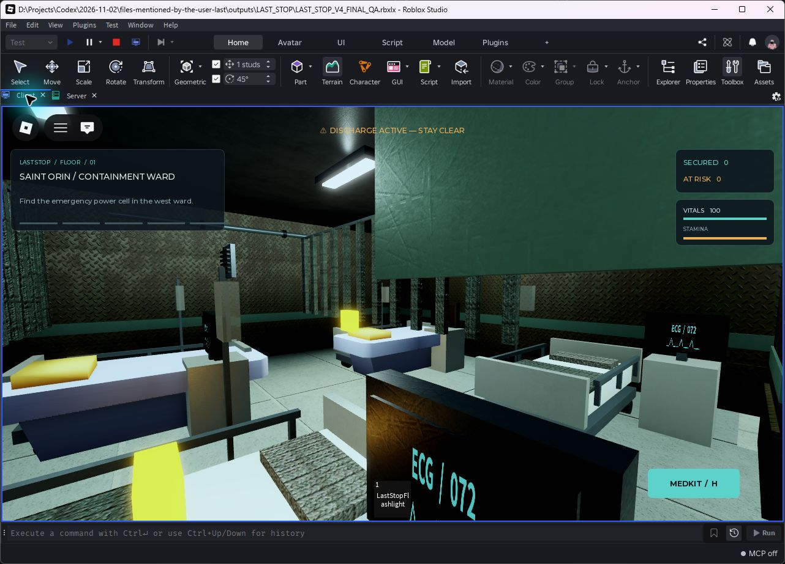
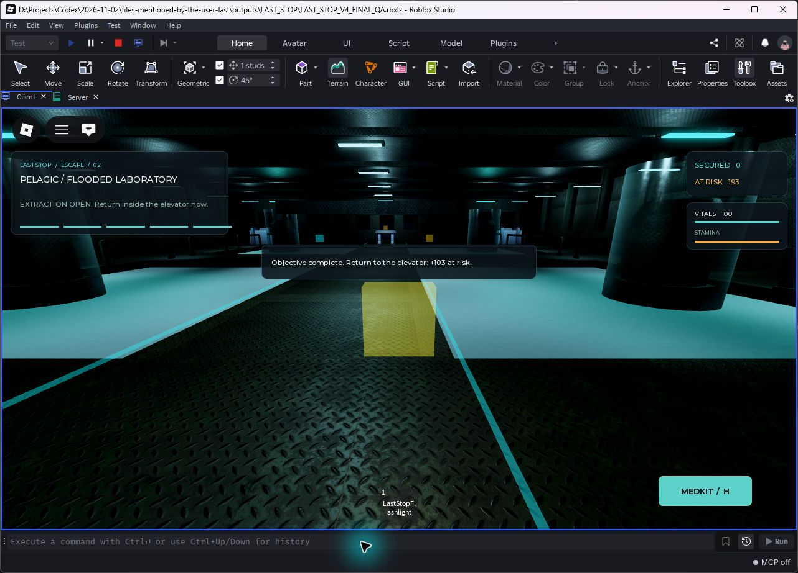
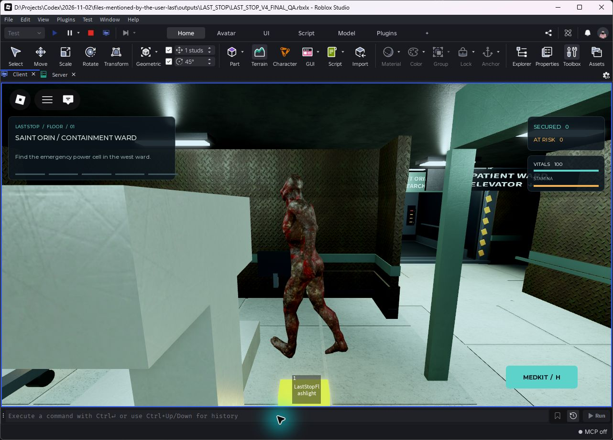

# V4 Containment acceptance — 2026-11-03

The deliverable is LAST_STOP.rbxlx at the repository root. Its build marker is **V4 CONTAINMENT**. The exact build hash, source count and prefab inventory are recorded in [build-audit.json](build-audit.json).

## Executed checks

- The offline audit checks all 33 Lua sources against the rebuilt place, Studio Source size limits, all six script-free prefabs, 18 imported environment meshes, the 61-bone creature, its four uploaded asset IDs and all saved PBR material maps. The release floor limit is 240 seconds.
- Studio startup passes the existing pure-logic/security suite and prefab lifecycle regression. Both candidate power-cell positions have unobstructed player-head and third-person camera rays. Two clone/cleanup cycles preserve source prefabs and unrelated authored siblings.
- Two real local clients passed the isolated integration test at 15:00 local time. It exercised both floors, navigation to every target, physical Stalker movement, visible windup and bounded 20-point damage, bounded 8-point environmental damage, out-of-order/duplicate rejection, two-operator controls, solo fallback, carrier-loss recovery, delivery, extraction, independent BANK/CONTINUE and reward isolation. The fixture uses disposable in-memory profiles and shortened phase timings. [Server output](multiplayer-output.txt)
- A client helper completed two normal floors through RequestQueue, real ProximityPrompt hold input, extraction, CONTINUE and BANK. The helper scripts character positions and camera angles. A subsequent hospital-specific run passed the repaired pickup, installation, controls, carried case, delivery, extraction and BANK through the same normal prompts. [Normal-flow output](studio-normal-output.txt) · [Hospital regression output](hospital-regression-output.txt)
- Instance-based ContentProvider preloads reported 114 successful hospital callbacks and 161 successful laboratory callbacks with zero nonempty content failures. After the extra hospital equipment chests were added, the hospital reported 116 successes. Empty optional content slots are excluded. Both positional creature sounds and all four ambient/feedback sounds reported loaded.
- Live clients observed 61 creature bones, nonzero animation transforms and changing poses. The final focused enemy regression verifies that attack-range contact resets stuck recovery, a genuinely stuck distant approach retains recovery, and the imported bind-mesh bottom meets the floor at zero studs. This focused regression followed the two-client run. [Enemy recovery output](stalker-recovery-output.txt)
- Sprint reached 23 studs/second while draining stamina, released to 16 and disabled during carrying at 12. The iPhone XR Studio simulator showed readable landscape and portrait layouts with separate RUN, medkit and jump controls. Mobile objective prompts and the checkpoint modal were exercised. [Mobile output](studio-mobile-output.txt)

## Observed desktop performance

Ten-second RenderStepped samples at a 1274 × 677 gameplay viewport measured approximately 60 FPS on both floors. Hospital p95 frame time was 18.17 ms and laboratory p95 was 18.16 ms. Studio's reported memory was approximately 2 GB in those sessions. A later iPhone simulator sample at an 801 × 413 safe viewport also measured about 60 FPS and 18.08 ms p95 on this desktop computer.

These measurements cover the local desktop and emulator. Physical mobile devices, low-end hardware and twelve-client load remain unverified. Streaming, shared mesh/material reuse, bounded particle rates and distance-limited 30 Hz bone interpolation are enabled.

## Real Studio screenshots

Images are direct native-window screenshots of running Studio clients. Cameras and character positions were scripted. An invisible ForceField protected the capture player. The earlier desktop hospital, laboratory and Stalker scene shots used a QA place with a 3600-second floor limit. Canonical-place objective and mobile captures use the release 240-second limit. Mobile captures precede the final stuck-recovery correction and verify the HUD layout. The final normal-play session resets all temporary capture settings.

Additional evidence includes [landscape touch layout](mobile-landscape.png), [portrait touch layout](mobile-portrait.png), [mobile checkpoint](bank-continue-mobile.png) and [two-client PASS](multiplayer-pass.png).

## Scope and remaining verification

The detailed V4 attachment was unavailable in this session. Implementation followed the explicit requirements in the user's message. The industrial CC0 art direction and synthesized audio treatment were implementation choices. Asset sources, licenses, IDs and reproduction tools are recorded in [the asset manifest](../../ART_ASSETS_V4.md).

The existing profile schema, UpdateAsync save path, economy and remote validation are preserved. Unpublished Studio uses session-only fallback. Live DataStore round trips, Roblox publication and published-experience asset permissions remain unverified. The place and source are delivered through GitHub.
